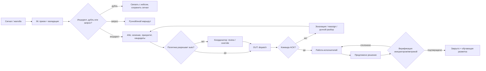

# 01. Предметная область, границы процесса и временные затраты

**Статусы утверждений:** [Внешний факт] означает опубликованную практику, **не процесс МТС**; [Участники] — из [встречи 20.11.2026](../../../meetings/2026-11-20/summary.md); [Гипотеза] — дизайн MVP; [Пробел] — требуется подтверждение.

## 1. Таксономия

| Сущность | Операциональное определение для проекта | Отличительный признак |
|---|---|---|
| Сигнал (signal) | Сырой симптом: сообщение, звонок, замер | Не всегда событие/инцидент; может быть шумом |
| Событие (event) | Зафиксированное состояние/изменение с источником и временем | Событие наблюдаемости необязательно означает нарушение услуги |
| Alert | Правилом/моделью отобранное событие, требующее внимания | Может образовывать группу, быть suppressed/resolved |
| Обращение/тикет (case) | Учётная запись взаимодействия с инициатором | Может быть инцидентом, запросом или ошибочной жалобой |
| Инцидент | Предполагаемое незапланированное нарушение или деградация услуги, требующее восстановления | Может включать несколько событий, обращений и задач |
| Проблема (problem) | Причина или потенциальная причина одного/нескольких инцидентов | Root cause investigation длится дольше непосредственного реагирования |
| Изменение (change) | Планируемое/контролируемое изменение услуги/конфигурации | Может породить инцидент, но не тождественно инциденту |
| Запрос услуги (service request) | Запрос на предоставление услуги/доступа/информации | Не считать автоматически сбоем |
| Triage | Проверка актуальности, типа, влияния, срочности и владельца | Операция до/во время первой маршрутизации |
| Escalation | Передача на иной уровень компетенции/ответственности либо уведомление при таймауте | Не равно исправлению |
| ACK | Явное подтверждение ответственным получения **и принятия** работы | Не равно уведомлению/полному решению |

**[Внешние факты]** Различие incident, problem и service request соответствует [Atlassian ITSM, S04/S05](sources.md#s04), а разделение координации и operational resolution — [Google SRE, S01/S02](sources.md#s01); у PagerDuty ACK останавливает эскалацию, но не закрывает инцидент [S06](sources.md#s06). Это переносимые идеи, **не доказанный регламент МТС**.

**[Участники]** «Клиентский / пользовательский / технический» на [записи 153](../../../meetings/2026-11-20/transcripts/recording-153.md) — незавершённая классификация происхождения. **[Рекомендация]** Разделить оси: `source_kind=customer|employee|monitoring|operator`, `record_kind=signal|incident|service_request|unknown`, `impacted_service`, `incident_class=client|employee|technical|unknown`. «Технический» иногда будет исходить от клиентского канала; эти оси не обязаны исключать друг друга.

## 2. Сценарий и зоны ответственности

| Роль | Отвечает | Не предполагается автоматически |
|---|---|---|
| Инициатор | Сигнал, дополнительный контекст, подтверждение результата (если применимо) | Доступ к служебным деталям всех инцидентов |
| Координатор / incident owner | Триаж, контроль ACK, эскалация, корректировка маршрута, журнал | Изменение production-систем |
| Team lead / primary resolver | Принятие и координация восстановления | Автоматическое подтверждение, что всё исправлено |
| Contributing team | Частичная задача, контекст, технический результат | Право закрыть весь инцидент без общего owner |
| Наблюдатель / аудитор | Просмотр согласованной по роли истории и KPI | Изменение приоритета или назначения |

**[Внешний факт]** Google SRE разделяет incident command, operations и communications; операционные изменения выполняют ответственные исполнители [S01](sources.md#s01). **[Участники]** В [152](../../../meetings/2026-11-20/transcripts/recording-152.md) явно обсуждалось, что роль координатора — распределение и контроль, а не принятие ответственности команды за устранение.

## 3. Где может теряться время

Ниже **каузальные гипотезы**, а не замеренная структура затрат МТС.

| Этап | Возможный bottleneck | Логировать | Предлагаемое сокращение |
|---|---|---|---|
| Intake | Ручное переписывание из бота/алерта | `source_emitted_at`, `received_at`, `normalized_at` | Адаптеры и контракт |
| Triage | Неполная жалоба, множество контекстов | `triage_started_at`, `triage_finished_at`, missing_fields | Показ недостающих полей, prefill |
| Поиск ответственного | Ручной поиск регламента/чатов | `candidate_set`, `choice_at`, `policy_version` | Сервис→команда + ranking |
| Проверка критичности | Неясен масштаб и влияние | `priority_decision_at`, evidence | Явные поля impact/urgency |
| Dispatch | Копирование в другой канал | `dispatch_requested_at`, `delivered_at` | OUT с correlation ID |
| ACK wait | Молчание команды / неопределённый адресат | `ack_due_at`, `acked_at`, attempts | Отдельный ACK+эскалация |
| Reassignment | Ошибочный первый адресат | assignment history / reject reason | Обучение на успешном owner |
| Verification | Нет уверенности в устранении | proposed/verified timestamps | Source-aware verification |

**Проверка гипотез:** на хотя бы 20–30 разрешённых и обезличенных кейсах, если предоставят, восстановить временную диаграмму событий; провести наблюдение/интервью 2–3 координаторов с разрешением заказчика; на синтетике дать controlled demo, **но не приписывать синтетический выигрыш бизнесу**.

## 4. Сравнение практик и применимости

| Практика/первичный источник | Что технически обосновано | Ограничение применимости |
|---|---|---|
| [Google SRE, Incident Response, S01](sources.md#s01) | Commander / Ops / Comms, общий журнал, понятная ответственность | Описывает SRE крупных систем; не описание МТС |
| [Google SRE, Managing Incidents, S02](sources.md#s02) | Командная роль, единая координация, разделение задач | Должно быть адаптировано к ITSM |
| [Google SRE, Alerting on SLOs, S03](sources.md#s03) | Снижение ложных уведомлений, ориентир на пользовательский эффект | Формулы burn-rate только при наличии SLO |
| [PagerDuty, S06](sources.md#s06) | Отдельный ACK; цепочка escalation timeout | Продуктовый пример; нет основания переносить таймаут 30 минут |
| [Prometheus Alertmanager, S07](sources.md#s07) | Дедупликация, группировка, inhibition/silencing | Внутри конкретного стека; МТС мог использовать другое |

Количественные отраслевые бенчмарки «среднее время координатора» **не установлены**: подходящие первичные данные о сопоставимых проектах и эффекте автоматизации МТС отсутствуют. **[Рекомендация]** Использовать заранее опубликованный протокол измерения, а не произвольную цифру «ускорили в N раз».

## 5. Непрерывность показателей и ошибок

- Если один массовый сбой вызывает 200 обращений, хранить 200 `source_events` и один/несколько обоснованно связанных `incidents`, а не автоматически 200 отдельных инцидентов.
- Если письмо доставлено, но команда не нажала «Принять», `time_to_ack` продолжает расти.
- Если первая команда ответила ACK, но независимый эталон указал, что она не компетентна, этот ACK не должен считаться «валидной реакцией» в оценке routing.
- Если команда восстановила сервис, но подтверждение ещё ожидается, фиксировать отдельно `restored_at` (при подтверждении техническими данными) и `verified_closed_at`.
- Если меняют приоритет, сохранять всю историю оценок и дедлайнов с временами действия [см. политику](04-sla-priority-lifecycle.md).

[Далее: IN и canonical data](02-input-channels-and-data.md) · [Источники](sources.md).
