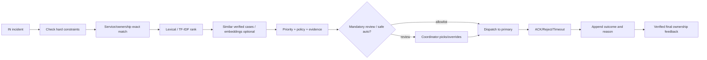

# 03. Каталог команд, владение сервисами и маршрутизация

**Применимость:** весь каталог ниже — **синтетический**. В [записи 153](../../../meetings/2026-11-20/transcripts/recording-153.md) упоминаются команды рабочих станций, СУБД, коммутаторов; это не данные реального штатного расписания МТС. [Внешняя практика] Разделение Incident Commander и Ops Lead подтверждается [Google SRE, S01/S02](sources.md#s01).

## 1. Нормализованные сущности

| Таблица/сущность | Основные поля | Ключевой инвариант |
|---|---|---|
| `team` | `team_id`, name, support_tier, regions, skills, active, cost_center?(optional), catalog_version | Идентификатор стабилен при переименовании |
| `service` | `service_id`, aliases, criticality, dependencies, regions, catalog_version | Один алиас не должен неоднозначно означать два сервиса без review |
| `ownership` | `service_id`, `team_id`, role=`primary|secondary|consulted`, valid_from/to, region | На `(service,region,valid_time)` — понятный primary или явно «конфликт» |
| `oncall` | team, schedule_ref, window, escalation_policy_id | Пустое расписание => ручная эскалация; не invent on-call |
| `team_dependency` | from, to, purpose, ordering | Возможны циклы; определять на уровне задач, не recursive reassignment |
| `assignment_attempt` | incident, team, actor, proposed_at, sent_at, delivered_at, acked_at, rejected_at, reason, attempt_no | История append-only; один active primary |
| `incident_team_task` | incident, team, scope, task_status, evidence_ref | Несколько параллельных задач под одним owner |
| `routing_feedback` | incident, ground_truth_owner, resolution_verified, rejected_teams, reason, reviewer, recorded_at | Метка успешного маршрута только после проверки |

**[Гипотеза]** Синтетический каталог MVP:

| ID команды | Специализация | Owned services | Триггеры/ограничения | Эскалация |
|---|---|---|---|---|
| `team-workplace` | Workplace / L1 | laptop, vpn-client, office-wifi | Только рабочие места; не core network | `team-network` |
| `team-network` | Network / L2 | core-network, vpn-gateway, switch | Не аппаратные жалобы без связи с сетью | `coord-senior` |
| `team-dba` | Database / L2 | postgres, database-storage | Требует указания DB service/evidence | `coord-senior` |
| `team-backend` | Application backend / L2 | balance-api, user-api | API/бизнес-логика; не автоматически root cause | `team-platform` |
| `team-platform` | Platform/SRE / L2 | kubernetes, deploy-platform, ingress | Infra, deployments, cross-service alerts | `coord-senior` |

`coord-senior` здесь **эскалационная роль**, не придуманная команда МТС; `region` можно `demo-r1/demo-r2` с разрешением `all`.

## 2. Пример записи команды (не МТС)

```json
{
  "catalog_version": "demo-team-v1",
  "team_id": "team-backend",
  "name": "Application Backend (synthetic)",
  "support_tier": 2,
  "owned_services": ["balance-api", "user-api"],
  "skills": ["http-api", "business-logic", "latency-triage"],
  "regions": ["demo-r1", "demo-r2"],
  "availability": {"type": "demo_24x7", "oncall_ref": null},
  "primary_contacts": [],
  "escalation_policy": ["coord-senior"],
  "active": true,
  "source": "SYNTHETIC"
}
```

**[Рекомендация]** Набор `ownership` должен быть документирован и версионирован; не заменять его похожестью текста. Отдельно показать в UI, когда зона ответственности **неизвестна**.

## 3. Decision pipeline и приоритет источников



**Порядок:** (1) запретные ACL/region/active/service rules; (2) подтверждённый каталог ownership; (3) проверка on-call/роли; (4) вероятностные признаки и завершённые кейсы для переупорядочения допустимых команд; (5) ручной override с обязательной причиной и аудитом.

Конфликты:
- `hard_rule DENY` преобладает над любым LLM score; если кандидатов нет — `ABSTAIN`.
- `service_owner` сильнее сходства текста, *но* при конфликте между сервисом и наблюдениями требуется review, а не уверенная слепая рассылка.
- `availability` отвечает за *кому можно отправить сейчас*, а не за техническую компетенцию; не выбирать чужую команду только потому, что она online.
- `priority` и `routing team` два разных решения: высокую критичность можно установить без уверенного owner; передавать координатору.
- `override` разрешён роли coordinator с audit reason, не переписывает модель `team` и не удаляет негативные метки.

## 4. Сравнение методов

| Метод | Преимущества | Слабые места | Роль в MVP |
|---|---|---|---|
| Exact mapping service→team | Детерминированно, быстро, аудируемо | Не покрывает неизвестные сервисы | P0, первичный фильтр |
| Keywords/regex | Просто показать rationale | Синонимы, склонения, отрицания | P0 как baseline |
| TF-IDF char/word n-grams | Прозрачный текстовый baseline, CPU | Не понимает сложную семантику | P1 |
| Sentence embeddings | Нечёткие формулировки, похожие кейсы | Доменный сдвиг, менее интерпретируемо | P1 при времени |
| RAG over *verified cases* | Находит контекст истории и объяснение | Ошибочные кейсы/PII/утечка, latency | P2 / ограниченный read-only |
| LLM classifier/ranker | Гибкость на длинном тексте | Нестабильность, prompt injection, цена | Только optional suggestion |

[TF-IDF — первичная документация scikit-learn, S12](sources.md#s12); [OWASP LLM01, S15](sources.md#s15). Нет данных, что какая-то модель превосходит baseline **в данной постановке**; требуется эксперимент.

## 5. Успешное назначение и «память неправильного»

**Критический инвариант:** `first_assigned_team != ground_truth_team` в общем случае. В примере встречи «backend → platform» успешную команду определять по **финальному подтверждённому исходу**, а не по последнему текстовому комментарию.

```json
{
  "incident_id": "inc-demo-31",
  "attempts": [
    {"attempt": 1, "team_id": "team-backend", "outcome": "REJECTED", "reason": "infra_symptom", "elapsed_seconds": 180},
    {"attempt": 2, "team_id": "team-platform", "outcome": "ACKED_AND_RESOLVED", "elapsed_seconds": 360}
  ],
  "verified_by": "initiator",
  "resolution_verified": true,
  "final_owner_team_id": "team-platform",
  "negative_examples": [{"team_id": "team-backend", "reason": "not_owner_for_fault_family"}],
  "learning_status": "REVIEWED_SYNTHETIC"
}
```

*Учить осторожно:* `REJECTED` не всегда значит «некомпетентен» (может быть нет смены/доступа); `ACKED` не значит исправил; `CLOSED` без проверки не означает качественный label. Признаки исторической частоты не должны «цементировать» плохую предыдущую маршрутизацию. Negative examples требуют типизированной причины и срока применимости; feedback может быть отозван/исправлен с версионированием.

## 6. Несколько команд и согласование

Модель: `incident.primary_team_id` — один **accountable owner** (если не назначен — явно null + human review); `incident_team_tasks` — 0..N contributing teams. Каждая задача имеет отдельный ACK; общий ACK считается только если primary принял, остальные ACK отображаются отдельно. Параллельность нескольких команд не означает несколько первичных дедлайнов, скрывающих общий deadline.

**[Гипотеза]** Если `team-backend` ведёт incident, а `team-dba` исследует БД, закрытие возможно только после central verification, а не после частичного «готово» одного участника. Эскалация и передача primary фиксируются атомарно с новым `assignment_attempt`.

## 7. Проверяемые случаи

`ROUTE-01`: known service + active owner => top1 owner по правилу. `ROUTE-02`: неизвестный сервис => abstain и запрос контекста. `ROUTE-03`: model советует команду вне разрешённого региона => нельзя dispatch. `ROUTE-04`: два primary владеют одним сервисом => ручной conflict. `ROUTE-05`: rejected backend → platform => первая команда остаётся в истории и становится negative evidence с причиной. `ROUTE-06`: недоступен on-call => escalation, не подмена компетенции. `ROUTE-07`: две команды => один accountable owner и две задачи. `ROUTE-08`: manual override ⇒ новые version, reason, actor.

**Открытые решения:** Q04–Q05/Q09–Q10/Q14: [реестр ответов](10-open-questions-answered.md). [ANL](05-analytics-ml-and-memory.md) · [OUT](06-outbound-hil-and-notifications.md).
