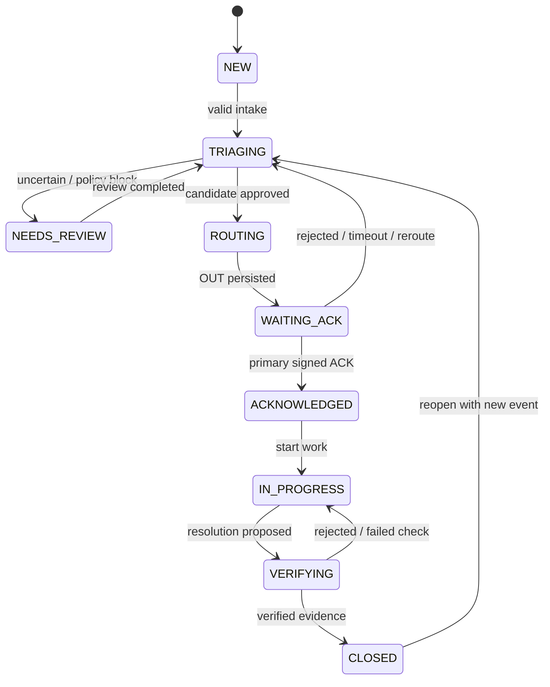

> Историческая редакция 20.11.2026. Объём MVP уточнён по официальному кейсу: [новая редакция](../../../requirements/incident-coordinator/official-case-revision.md). IN/ANL/OUT и ACK не являются обязательным ядром дашборда. Исходный текст сохранён ниже.

# 04. Приоритеты, SLA, таймеры и конечный автомат

**НЕЛЬЗЯ СЧИТАТЬ УСТАНОВЛЕННЫМ:** 2/6/12 часов озвучены [участниками записи 153](../../../meetings/2026-11-20/transcripts/recording-153.md), а сброс срока после повышения приоритета обсуждался в [154](../../../meetings/2026-11-20/transcripts/recording-154.md), но [D10/D12](../../../requirements/incident-coordinator/decision-log.md) **не утверждают** смысл, старт, календарь, паузы или reset. Все значения ниже — конфигурируемая **гипотеза демо**.

## 1. Отделить часы и понятия

| Клок | Событие старта (нужно согласовать) | Событие остановки | KPI |
|---|---|---|---|
| Ingress delay | `source_occurred_at` | `server_received_at` | Наблюдаемость задержки источника |
| Triage | `server_received_at` | `triage_completed_at` | Time to triage |
| First assignment | `server_received_at` | первый `dispatch_requested_at` | Time to first assignment |
| Delivery | `dispatch_requested_at` | `delivery_confirmed_at` | Outbound transport latency |
| ACK/response | `server_received_at` | `primary_acked_at` / `first_valid_owner_acked_at` | **Базовый KPI реакции** |
| Restore/mitigate | Время, установленное регламентом | доказанное восстановление услуги | Time to restore (отдельно) |
| Resolve | Время, установленное регламентом | предложено/принято решение | Time to resolve |
| Verify/close | `resolution_proposed_at` | `verified_closed_at` | Time to verified close |

**[Внешняя практика]** У PagerDuty acknowledgement останавливает escalation, но не закрывает incident [S06](sources.md#s06). **Не переносить** условия стороннего SaaS как SLA МТС.

## 2. Модель конфигурации (только демо)

```json
{
  "policy_id": "demo-illustrative-v1",
  "source": "SYNTHETIC_NOT_MTS",
  "time_zone": "UTC",
  "business_calendar_id": "demo-24x7",
  "priority_levels": {
    "P1": {"illustrative_restore_minutes": 120, "ack_budget_minutes": 15},
    "P2": {"illustrative_restore_minutes": 360, "ack_budget_minutes": 15},
    "P3": {"illustrative_restore_minutes": 720, "ack_budget_minutes": 15}
  },
  "clock_origin": "server_received_at",
  "reprioritization": "from_original_origin_preserve_history",
  "ack_deadline_scope": "per_primary_assignment_with_global_clock",
  "pause_policy": "no_pause_in_demo",
  "on_reopen": "same_incident_keep_original_history",
  "due_at_is": "UTC_INSTANT",
  "timer_labels": "DEMO_POLICY_NOT_OFFICIAL_SLA"
}
```

**[Рекомендация]** При хранении всегда разделять `priority` (оценка влияния) и конкретный `sla_policy_id` с версией. Для целей демо 2/6/12 используются как *illustrative restore budgets*, а ACK 15 минут — отдельная синтетическая величина. Ни один из этих сроков не заявлять как настоящий SLA.

## 3. Пересмотр приоритета: сравнить, не прятать прошлое

Предположим: событие `t0=00:00`, в `t=03:00` приоритет `P3` (12 ч) изменился на `P1` (2 ч). Ниже **возможные политики**, применимость зависит от договора.

| Политика | Новый P1 deadline | Плюсы | Риски |
|---|---|---|---|
| A: от первоначального события | **02:00**, уже 1 ч просрочки | Не стирает прошедшее время, консервативна | Может «штрафовать» за новое влияние, возникшее позже |
| B: reset от смены приоритета | **05:00** | Даёт полный новый бюджет | Может скрыть 3 часа предыдущей задержки |
| C: `min(old_due_at, change_at+new_budget)` | **05:00** | Не продлевает старый deadline (12:00) | Не обнаруживает breach по новой 2-часовой норме от `t0` |
| D: две шкалы | Сохранить старый 12:00, новый 05:00, отдельно оценить ретроактивный 02:00 | Максимальная прозрачность | Сложнее для оператора |

**[Предложение для MVP, не SLA МТС]** Визуально показывать **первоначальный и пересчитанный deadlines**, сохранять все `policy_decisions`; в симуляторе выбрать A для `demo-illustrative-v1`, ясно обозначить «демо-расчёт/возможная уже наступившая просрочка». Не трактовать это как установленный breach МТС и не сбрасывать журнал. По Q07 получить письменную политику, затем поменять конфиг, а не код. Для бизнес-часов функция `add_working_minutes(calendar, origin, budget)` вместо `origin + duration`.

## 4. Конечный автомат MVP



`DELIVERED` и `ACKED` — **отдельные OUT-флаги**, а не одно состояние. `ESCALATED`, `BREACHED` — события и флаги, а не обязательные взаимоисключающие lifecycle-статусы. `WAITING_EXTERNAL` и pause — не включать до утверждения правил; время в ожидании в MVP продолжает идти. После reopen создаётся `episode_id` с сохранением `incident_id` и исторических дедлайнов; новая метрика эпизода отдельно.

## 5. Инварианты состояния и доступа

1. `created_at <= updated_at` по server time; `occurred_at` источника может быть раньше/позже, проверять skew отдельно.
2. Уникальный active primary assignment для инцидента; contributing team tasks не меняют principal owner.
3. `acknowledged_at` не возникает из `delivery_state=DELIVERED`, только из явного actor action / доверенного подтверждения.
4. `CLOSED` возможен только при `verification.state=PASSED` и записи `verification.evidence_ref` (демо-стенд тоже обязан записать evidence).
5. Всякая смена `priority` записывает old/new, source, actor, `effective_at`, `policy_version`, прежний и новый due.
6. Отказ/timeout не удаляет прошлое назначение, не сбрасывает `server_received_at` и baseline clock.
7. Таймер на UI определяется серверным `due_at` и синхронизацией clock; неизвестное время/календарь => отображать «нет политики», а не нулевой дедлайн.
8. Breach — вычислимое событие `now > due_at AND stopping_event_absent` по **политике и версии**, не переписывать его при новой версии.
9. `CLOSED→TRIAGING` создаёт новый `episode_id`, audit `reopened_by`, `reason` и links; не задним числом меняет закрытие.
10. Не считать SLA замороженным из-за `WAITING_ACK`, `NEEDS_REVIEW`, outage канала, если не утверждена отдельная pause policy.

## 6. Граничные сценарии, ожидаемые результаты

| Сценарий | Проверяемое поведение |
|---|---|
| Повышение P3→P1 спустя 3 часа | Сохранить old P3 due, вычислить new P1 due по выбранной стратегии, отобразить возможный breach |
| Понижение P1→P3 | Прежний P1 breach остаётся в истории; разрешение продления только по политике |
| Смена команды до ACK | Первый attempt отклонён/таймаут, второй attempt с новым ID; глобальные clocks без reset |
| Массовая авария | Один master incident / связи child signals; не умножать SLA от числа сообщений |
| Две команды | Один primary ACK + отдельные ACK subtask; общий инцидент не закрыт частичным ответом |
| Задержанный старый alert resolved | Не закрывать новый firing episode; проверка поколения и времени |
| Спустя закрытие снова жалоба | Новый episode и trace reopen, без потери исторических показателей |
| Ночью, праздник, timezone | Calendar service в UTC + локальный display; в демо 24×7, не экстраполировать |

**[Пробел]** Подтвердить: градацию приоритетов, что значит 2/6/12, календарь, pause, origin, реакции/restore и владелец утверждения [Q06–Q08](10-open-questions-answered.md). [OUT](06-outbound-hil-and-notifications.md) · [Метрики](09-quality-evaluation-and-risks.md).
