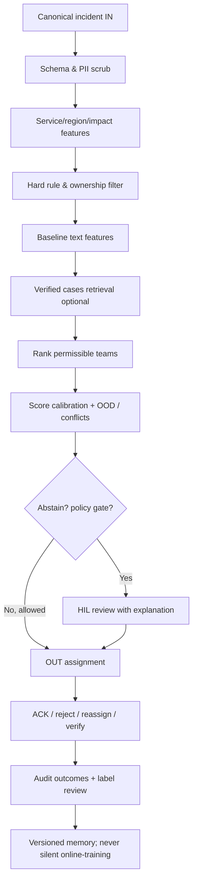

> Историческая редакция 20.11.2026. Объём MVP уточнён по официальному кейсу: [новая редакция](../../../requirements/incident-coordinator/official-case-revision.md). IN/ANL/OUT и ACK не являются обязательным ядром дашборда. Исходный текст сохранён ниже.

# 05. ANL: аналитическое ядро, модели, память и abstain

**Целевая функция:** сократить время **до валидного ACK компетентной команды**, при ограничении ошибочных автопередач. **[Участники]** Идея помнить путь «backend → platform» и не повторять первую ошибку [запись 153](../../../meetings/2026-11-20/transcripts/recording-153.md). Технологические варианты ниже — **рекомендации, не доказанное превосходство ML в МТС**.

## 1. Вычислительная цепочка



**Лог контракта решения:**
```json
{
  "decision_id": "anl-demo-55",
  "incident_id": "inc-demo-55",
  "model": {"name": "rules-tfidf-hybrid", "version": "demo-v1"},
  "policy_version": "route-v1",
  "team_catalog_version": "demo-team-v1",
  "input_fingerprint": "sha256-redacted-placeholder",
  "candidates": [
    {"team_id":"team-platform","score":0.83,"score_kind":"uncalibrated_rank","evidence":["service_owner","case-001"]},
    {"team_id":"team-backend","score":0.67,"score_kind":"uncalibrated_rank","evidence":["similar_description"]}
  ],
  "selected_team": null,
  "decision": "ABSTAIN",
  "reasons": ["missing_service_owner_confirmation","conflicting_evidence"],
  "elapsed_ms": 14,
  "actor": "system"
}
```
Числа score и latency здесь **синтетические примеры**, не замеренная производительность. `0.83` не является «83% вероятности» без калибровки [S13](sources.md#s13).

## 2. Честный comparison baseline

| Метод | Latency (качественно) | Объяснимость | Данные/стоимость | Риски |
|---|---|---|---|---|
| Service mapping + rules | Очень низкая | Высокая | Каталог обязателен; CPU | Неизвестные сервисы, правила устаревают |
| Regex/keywords | Низкая | Высокая | Словарь терминов | Синонимы, отрицания, высокий false-positive |
| TF-IDF char 3–5 + linear ranker | Низкая после обучения | Средняя (активные n-grams) | Нужны размеченные кейсы | Лексическая неоднозначность |
| Embedding nearest neighbors | Низкая/средняя в зависимости от модели | Через ближайшие примеры | Модель + индекс + train/eval | Смещение, OOD |
| RAG: retrieved case evidence | Средняя/высокая | Высокая при точных ссылках на кейсы | Хранение/ACL индекс + retriever | Непроверенные кейсы и чувствительные данные |
| LLM zero-shot/prompted | Нестабильная, выше | Explanation может быть ложным | Tokens/контекст/API | Prompt injection, output violations, стоимость |

**Примечание:** никаких миллисекунд/рублей в качестве внешних бенчмарков без тестовой среды не указывать. **Протокол**: warm/cold p50/p95/p99 каждого шага на одном оборудовании, токены/цены на дату запуска, memory, ретраи, нагрузка, доля abstain и полнота лога. [TF-IDF docs, S12](sources.md#s12) · [OWASP LLM risk, S15](sources.md#s15).

## 3. Признаки и ranking

Фичи: `service_id`, `region`, `impact_scope`, `affected_count_estimate` (с происхождением), alert labels, fault_family, текст после удаления персональных данных, наличие релевантных завершённых кейсов, evidence quality, статус on-call, версия ownership.

**[Рабочая гипотеза]** Score ранжирования кандидатов после фильтра:
`rank(team)=w1*ownership_match + w2*lexical_similarity + w3*verified_case_match + w4*availability_hint - w5*recent_verified_misroute_penalty`. Веса `w` подбирать на train, не фиксировать как «научно доказанные». Hard eligibility всегда поверх score. Если аналогичный кейс раньше передали неправильной команде, retrieval выдаёт и *почему не выбрали её*, а не только финальный team ID.

## 4. Training labels, memory и provenance

Структура памяти `case_memory`:
`case_id`; incident family; sanitized title; service, region, problem class; `routing_attempts[]` и отклонения; `final_primary_team`; `verified_outcome`; resolution/evidence reference; linked owner policy and version; timestamps; feedback reviewer; data permission; expiry/retention; `embedding_model_version`.

Распределить записи на классы:
- **Positive verified:** разрешение подтверждено, финальный owner компетентен, evidence доступно.
- **Negative routing evidence:** было неверное назначение с конкретной валидной причиной.
- **Unresolved / uncertain:** инцидент ещё открыт либо подтверждение отсутствует; можно показывать для операторского контекста с предупреждением, **нельзя** автоматически считать positive training label.
- **Superseded:** ownership изменён после миграции сервиса; версия и окно действия важнее старой частоты.

**Guardrails:** индекс строить только из ACL-разрешённых записей и обезличенного текста. Каждый фрагмент цитировать `case_id`, `team_id`, `policy_version`, `verified_at`. Отображать извлечённое доказательство отдельно от LLM narration. Prompt injection из текста жалобы или retrieval не должен запускать side effects [OWASP S15](sources.md#s15).

## 5. Confidence и политический gate

**[Рекомендация]** Сначала scoring & abstain без некалиброванной вероятности. Политики:
- `AUTO_DISPATCH` только при валидном exact service owner, бесконфликтном ownership, разрешённом канале, отсутствии P1 safety-block, подходящем on-call и явном allowlist; threshold tuning опционален.
- `RECOMMEND` показать top-3 с причинами, где нет hard block, но недостаточна уверенность.
- `ABSTAIN` неизвестный сервис, конфликт каталогов, source trust gap, отсутствующие критические поля, уязвимость/враждебный payload, no eligible team, OOD.
- Высокий priority не понижать автоматически из-за модели; contested changes требуют человека.

Когда появятся метки, отдельно калибровать на holdout [scikit-learn S13](sources.md#s13) и оценить selective risk–coverage: `coverage(τ)=auto_count/all_count`, `risk(τ)=misroutes_auto/auto_count`; 0 случаев auto ⇒ risk не определён, не записывать 0%. **[Гипотеза]** Для демо threshold `0.9` можно конфигурировать лишь после calibration; hard rules важнее числового порога.

## 6. Retrieval protocol

1. Query prefilter: same allowed tenant/service/region/time/version; safe text + event labels.
2. Retrieve top-20 candidate cases, rerank top-5 by lexical + structured match.
3. Remove unresolved/unverified cases from auto decision; include negative examples only как warning.
4. Produce `evidence[]` с ссылкой на конкретный verified case; без источника написать `no supporting cases`.
5. Human sees alternatives and evidence; every override logs reason.
6. Reindex только после `verified_closed` и review, с TTL/consent; не выполнять скрытое self-training.

**[Рекомендация]** Для MVP достаточно SQLite/Postgres + простого keyword/TF-IDF; vector DB не обязателен. Универсальный LLM не заменяет catalogue-of-record и строгую логику статусов.

## 7. Схема оценки моделей

Сравнивать `rules`, `rules+TF-IDF`, `rules+embeddings`, `rules+retrieval` на **одинаковых** группированных сценариях. Split по incident family/root incident, а не по повторным событиям: иначе родственники одного outage попадут одновременно train/test и завысят score. Отдельно измерять macro-F1, top-1/top-3 [S14](sources.md#s14), калибровку/abstain, ошибочную автопередачу, p95 latency. Для нескольких teams использовать multilabel metrics, не выдавать single-label top-k за полноценную оценку multi-team. Реальных меток МТС нет → все значения **ожидаемые поля отчёта**, не результаты.

**Проверки:** `ANL-01` hard deny не обходит LLM; `ANL-02` неизвестный сервис abstain; `ANL-03` ошибка «backend→platform» не обучает на backend; `ANL-04` incomplete case исключён из positive; `ANL-05` prompt injection остаётся данными; `ANL-06` изменение ownership version меняет допустимый pool; `ANL-07` каждое auto decision воспроизводится по versions и `input_fingerprint`.

[Каталог](03-team-catalog-and-routing.md) · [OUT](06-outbound-hil-and-notifications.md) · [Оценка](09-quality-evaluation-and-risks.md).
