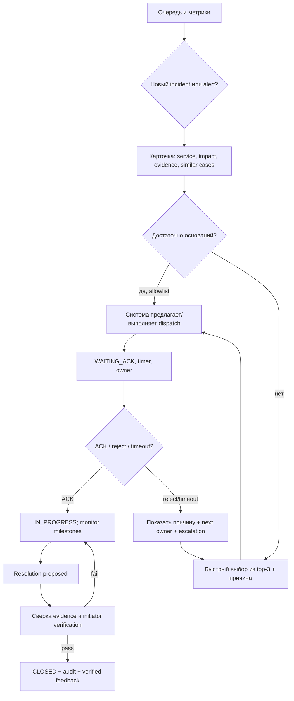
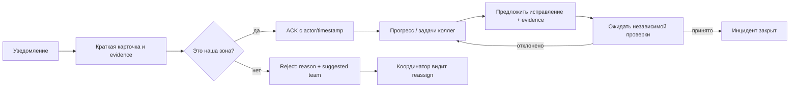
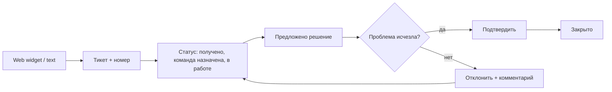

> Историческая редакция 20.11.2026. Объём MVP уточнён по официальному кейсу: [новая редакция](../../../requirements/incident-coordinator/official-case-revision.md). IN/ANL/OUT и ACK не являются обязательным ядром дашборда. Исходный текст сохранён ниже.

# 07. UX координатора, исполнителя и инициатора

**[Участники]** В [записи 154](../../../meetings/2026-11-20/transcripts/recording-154.md) предложены countdown, единый журнал сообщений, несколько координаторов и разгрузка чатов; [запись 153](../../../meetings/2026-11-20/transcripts/recording-153.md) предлагает интерактивный ввод жюри. **[Рекомендация]** UX — сокращение числа действий и ошибок routing, а не произвольная «красота». Все экраны ниже — **макеты поведения**, не существующий продукт.

## 1. Персоны и границы доступа

| Персона | Основная задача | Скоростная метрика | Предохранитель |
|---|---|---|---|
| Координатор | Разобрать неопределённость, выбрать owner, контролировать ACK/эскалации | Triage decision time + valid owner ACK | Никаких неподписанных изменений |
| Responder/team lead | Получить контекст, ACK/reject, запросить помощь, предложить результат | Team ACK latency, reassign rate | Видит только назначенные/доступные инциденты |
| Инициатор | Сообщить проблему, получить статус, проверить, что решено | Time to valid submission, verified response | Только собственные обращения |
| Руководитель/аудитор | Проверить журнал, реальную нагрузку, SLA-policy version | Достоверность evidence | Read-only, role-limited |

## 2. User flow координатора

**Decision points:** низкая уверенность, owner conflict, P1 hazard, неизвестный сервис, business-hour ambiguity, ложный дубль, replayed callback, вывод из карантина. Рядом с каждым показать действие *Почему?*, *Кто разрешил?*, *Как отменить?*.

## 3. User flow исполнителя

**Обязательно:** одна кнопка ACK; reason-coded reject; `need_more_context`; флаг подтверждённого ownership; ссылка на историю переписки инцидента. Не смешивать `read` и `ACK`.

## 4. User flow инициатора

Оговорка: для automatic alert инициатор — не человек; verification делается отдельным adapter и `UNKNOWN` при outage [см. OUT](06-outbound-hil-and-notifications.md).

## 5. Пять экранов MVP

| Экран | Минимальный content | Основной interaction | Чего избегать |
|---|---|---|---|
| **1. Live queue / control center** | ID, тип/сервис, P, owner, `time_to_ACK`, `time_to_restore` **с названиями**, статус, unread, риск | Sort by overdue/ACK risk, filter region/owner, select incident | Один таймер «до SLA» без указания типа |
| **2. Incident side panel** | Evidence provenance, исходное событие redacted, timeline, top-3, объяснение выбора, history attempts | Confirm route, one-click reassign с причиной, change priority | Длинные потоковые LLM-ответы без action |
| **3. Responder console** | Assigned incidents, pending ACK, reject codes, related tasks, status/evidence | ACK/reject/start/propose solution | Приравнивание «увидел» к ACK |
| **4. Initiator web widget** | Форма/номер, milestones, запрос подтвердить результат | Submit, confirm, reject | Внутренние логи и PII коллег |
| **5. Audit / performance** | Переходы, actor/reason, latency bars, operator overrides, policy versions | Drilldown, filter, export redacted | Недоказанные «-40%» на реальных системах |

**Countdown:** сервер возвращает UTC `due_at`, `now_server_at`, `policy_origin`, `budget_type`; клиент считает `remaining = due_at - (client_now + sampled_skew)`. После clock drift/переподключения обновить server offset. Синтетические сроки явно маркировать `DEMO`. Показать два значения «до ACK» / «до восстановления», `—` если нет политики.

## 6. Multi-coordinator coordination

**[Пробел]** Реальные регионы, очередь, права и рабочие смены неизвестны [Q16/Q21](10-open-questions-answered.md). **[Рекомендация]** Операции `claim`, `reassign`, `priority_update` — с optimistic concurrency: `UPDATE incidents SET ... version=version+1 WHERE id=? AND version=?` и проверка `row_count=1`; при конфликте UI показывает «изменено другим координатором» и новую версию, не теряет данные. Для выборки незанятых элементов в PostgreSQL доступно `FOR UPDATE SKIP LOCKED` в queue-like workload [S18](sources.md#s18); не применять его для полного чтения аналитики.

**[Гипотеза]** В demo очередь назначается по least-active-load с лимитом `max_active` и возможным `region_match`; не превращать число тикетов в показатель реальной сложности. Важно учитывать P1, длительность в ожидании, компетенции координатора и ручной transfer. `owner_coordinator_id` может быть null только в unclaimed queue; изменения уведомляются по версии.

## 7. События, unread, доступность

WebSocket/SSE сообщает `incident_id, version, event_type` без сырого текста и ПДн; клиент догружает карточку по ACL и сверяет version. Unread считать по `last_seen_event_id` для конкретного actor, не обнулять всем при чтении одного. Accessibility: клавиатурная навигация, ясные текстовые статусы, контраст, не полагаться только на красный/зелёный, статус таймера с aria-live **не чаще разумного** (избегать спама screen reader). Каждое массовое уведомление должно иметь aggregation и cooldown.

## 8. UX-исследование без псевдоэффекта

Провести task-based usability test на 6–10 участниках-заместителях (это **предлагаемый размер**, не статистический отраслевой стандарт), отдельно обычный и ошибочный маршруты. Замерять число кликов, ошибки, время до корректного назначения, понимание различия `DELIVERED`/ACK, реакцию на два таймера, доступность карточки. Сначала baseline интерфейс с ручным поиском, потом эксперимент с подсказками; randomized/counterbalanced order и одинаковые сценарии. При возможности позже повторить с **реальными координаторами с разрешения заказчика**.

[Демо](08-mvp-demo-and-synthetic-data.md) · [Метрики](09-quality-evaluation-and-risks.md) · [Вопросы](10-open-questions-answered.md).
