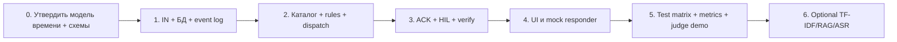

> Историческая редакция 20.11.2026. Объём MVP уточнён по официальному кейсу: [новая редакция](../../../requirements/incident-coordinator/official-case-revision.md). IN/ANL/OUT и ACK не являются обязательным ядром дашборда. Исходный текст сохранён ниже.

# 08. MVP, синтетические данные и сценарий жюри

**Статус:** **план и спецификация**, не код и не результаты эксперимента. История заказчика, полные регламенты, стендовые API и реальные пользователи не предоставлены. Материалы команды: [153](../../../meetings/2026-11-20/transcripts/recording-153.md), [154](../../../meetings/2026-11-20/transcripts/recording-154.md).

## 1. Scope: MUST / SHOULD / NOT NOW

| Приоритет | Функция | Критерий приёмки |
|---|---|---|
| **MUST (P0)** | Web-text intake + mock Grafana + жалобы → один IN | Все проходят одинаковую валидацию/normalization; 8 входных fixture из [02](02-input-channels-and-data.md) |
| **MUST** | Синтетический каталог и hard-rule routing | Не назначает чужую команду при hard deny, есть ручной override |
| **MUST** | Явные states `QUEUED/SENT/DELIVERED/ACKED/VERIFIED` | Тесты OUT-01..10 и жизненного цикла |
| **MUST** | Control center, incident detail, responder ACK, initiator verify | На экране виден countdown с типом clock и пометкой DEMO |
| **MUST** | Event log, baseline vs ANL, отчёт по метрикам | Никаких реальных эффектов МТС; счётчики из событий |
| **MUST** | Ошибочный маршрут, отсутствие ответа, отказ источника, priority change | Демо позволяет запускать повторяемый сценарий |
| SHOULD (P1) | TF-IDF baseline, top-3 + retrieved verified cases | Прозрачные evidence refs, можно abstain |
| SHOULD | Multi-coordinator claim/version, нагрузка и alerts grouping | Конфликт версии завершается явным сообщением |
| OPTIONAL (P2) | Embeddings/RAG, визуализация похожих кейсов | Read-only, без чувствительных данных |
| OPTIONAL | Voice note → ASR → тот же контракт | Демонстрация без телефонии |
| **DEFER** | Продуктивная МТС-интеграция, автоустранение, real-case learning, security-sensitive actions | Только после разрешения и требований |

**Архитектура рекомендуемого стенда:** Web/Vite (queue+card+bot) → backend API (FastAPI или эквивалент) → PostgreSQL/SQLite для incident/event log → worker mock OUT → rules/TF-IDF ANL → simulator clock + fixtures. Не зависеть от внешнего LLM/API для обязательного сценария. Deployment offline/local допустим, все данные **DEMO**.

## 2. Specification генератора синтетики

**[Рабочая гипотеза]** Примерная сетка для воспроизводимого pilot, не статистика МТС.

| Измерение | Генерация | Проверка |
|---|---|---|
| Объём | 600 *episodes*, 3 seed (42/43/44), событий больше эпизодов | 600 уникальных episode ID на seed |
| Incident family | balance-api, vpn, network, DB, deploy, workplace | Не менее 5 семейств |
| Priority | P1 10%, P2 25%, P3 65% (синтетический дисбаланс) | Проверять частоты с допуском из-за округления |
| Source | monitoring 40%, complaint aggregate 30%, employee/web 30% | 3 источника и различная provenance |
| Duplicate delivery | 15% событий повторить с *тем же* source/id/revision | Дубликаты не порождают новый incident |
| Correlated bursts | 20% episodes с 3–20 signal per incident | Не сплющивать события в одну запись |
| Misroute | 15% eligible assignments в симуляторе reject | История хранит неверную и финальную команды |
| Missing/conflicting fields | 10% episodes | `ABSTAIN` / review, не bogus confidence |
| Reprioritization | 5% episodes (в том числе +3 ч → P1) | Old/new deadlines сохранены |
| Multi-team | 10% episodes | Primary + contributing, разные ACK |
| Source/OUT outage | 5% episodes | DLQ/verification UNKNOWN без потери |
| Human reject verification | 5% resolved proposals | Reopen/in-progress, не закрыто |
| Adversarial text | Отдельный test partition, не training | Нет bypass policy/secret disclosure |

**Важно:** проценты для отдельных измерений пересекаются и **не обязаны суммироваться до 100%**. Не устанавливать независимые переменные заведомо взаимоисключающими. Для simulation ground truth задаётся до text generation: `fault_family → actual_service → final_owner`, затем каналы, затем noise и правдоподобные ошибки, чтобы не «подсмотреть» правильный ответ в готовом текстовом шаблоне.

Разделение `train/val/test=60/20/20%` по **семействам вариантов root case/коррелированным кластерам** без leakage. По времени отдельно out-of-time test. При 5 базовых семействах split по семьям слишком груб: генерировать множество независимых root-cause templates и группировать по `scenario_template_id`, сохраняя представленность классов; дополнительно hold out 1 целое семейство для OOD. Сохранять `seed`, `generator_version`, `truth.jsonl` и `events.jsonl` (в репо позднее, не реальные кейсы).

## 3. Data contract generator

```json
{
  "generator_version": "demo-data-spec-v1",
  "seed": 42,
  "incident_episode_id": "ep-0042",
  "ground_truth": {
    "fault_family": "platform_deploy_regression",
    "real_owner_team_id": "team-platform",
    "acceptable_contributing_team_ids": ["team-backend"],
    "priority_at_intake": "P3",
    "priority_changes": [{"offset_seconds": 10800, "new_priority": "P1"}],
    "expected_verified_result": true
  },
  "signals": [
    {"offset_seconds": 0, "channel": "web_form", "template_id": "t-plat-1"},
    {"offset_seconds": 45, "channel": "monitoring", "template_id": "a-plat-1"}
  ],
  "outbound_script": [
    {"assignment_no": 1, "team_id": "team-backend", "action": "REJECT", "delay_seconds": 120, "reason": "NOT_OWNER"},
    {"assignment_no": 2, "team_id": "team-platform", "action": "ACK", "delay_seconds": 75}
  ],
  "synthetic": true
}
```

**[Рекомендация]** Отдельно хранить скрытую для ранкера `ground_truth` (независимый oracle) и открытый пользователю `observable_input`, иначе оценка автоматизации будет самоисполняющейся. Не подмешивать метку `real_owner_team_id` в описание жалобы/embedding. Данные можно сгенерировать алгоритмически на основе шаблонов: это не «LLM-эмпирика МТС».

## 4. Последовательный демо-скрипт для жюри

| Шаг | Действие судьи/ведущего | Что видно на экране | Доказательство |
|---|---|---|---|
| 1 | Послать текст «Не отображается баланс» | Web widget → событие IN с origin | Новый source ID, 1 incident |
| 2 | Подать 10 синтетических похожих жалоб + mock alert | Корреляция, count, evidence refs | Отдельные source_events и один связанный incident |
| 3 | Открыть карточку | Сервис, приоритет **DEMO**, top-3, rationale, 2 clocks | ANL decision event и source provenance |
| 4 | Подтвердить route к backend | `QUEUED→SENT→DELIVERED`, ACK продолжает тикать | Нет ложного ACK |
| 5 | Нажать на responder «Не наша зона» | Reject reason, suggested platform, reassign | Негативная история сохранена |
| 6 | Platform нажимает ACK | Countdown остановился только на ACK валидного owner | `time_to_valid_owner_ack` |
| 7 | «Сервис восстановлен», но инициатор говорит «всё ещё ошибка» | `VERIFYING→IN_PROGRESS` | Не закрылся без подтверждения |
| 8 | Второй раз подтвердить через initiator | `CLOSED`, audited verified outcome | Final label platform, не backend |
| 9 | Запустить «прошло 3ч, P3→P1» в отдельном episode | Старый/новый due, пояснение политики, possible overdue | Видна неопределённость семантики |
| 10 | Показать benchmark панель | Baseline и assisted mode на *одном seed*, отдельно median/p90/CI | Маркировка synthetic-only |

**Вариант короткого показа:** steps 1→3→4→5→6→8; после — отдельные quick cards для outage, priority-change и mass incident.

## 5. Simulation clock и не-подмена SLA

При `speed_multiplier=10` сервер рассчитывает `sim_now = sim_origin + (monotonic_real_elapsed × 10)`, и **все** event scheduling, deadlines, уведомления и mock ACK используют **одни и те же simulated timestamps**. В отчёте по производительности не путать simulated wall time с реальным пользовательским latency. Возврат к ×1 сохраняет `sim_origin` и audit о смене скорости; пользовательские действия в логах содержат реальное monotonic duration и симулированный timestamp. Подписи `SIMULATED ×10` и `NOT OFFICIAL MTS SLA` на UI.

Скрипт реплея для сравнения должен быть **детерминирован** при неизменном seed, версии policy и сценария команды. Для ручного baseline зафиксировать экспериментальную задачу и идентичный input, но нельзя считать scripted delay времени человека человеческим baseline.

## 6. Возможная последовательность короткого хакатона



**Критический путь:** 0→5. Каждая стадия имеет контрактную проверку и не зависит от внешней телефонии. Если времени не хватает: убрать voice/RAG, **не** audit, ACK, retries и verifier. Предлагаемые интерфейсы: `POST /v1/inbound`, `GET /v1/incidents`, `GET /v1/incidents/{id}`, `POST /v1/incidents/{id}/assignments`, `POST /v1/assignments/{id}/ack`, `POST /v1/assignments/{id}/reject`, `POST /v1/incidents/{id}/propose-resolution`, `POST /v1/incidents/{id}/verification`, `GET /v1/metrics`, `POST /v1/demo/replay` — **предложения, не существующие API**.

[ANL](05-analytics-ml-and-memory.md) · [Quality](09-quality-evaluation-and-risks.md) · [Roadmap](11-recommended-decisions-and-roadmap.md).
