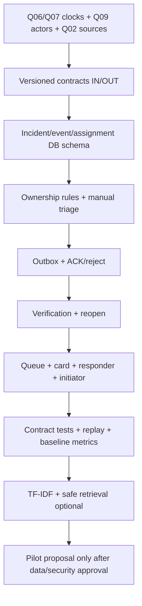

> Историческая редакция 20.11.2026. Объём MVP уточнён по официальному кейсу: [новая редакция](../../../requirements/incident-coordinator/official-case-revision.md). IN/ANL/OUT и ACK не являются обязательным ядром дашборда. Исходный текст сохранён ниже.

# 11. ADR, приоритеты решений и roadmap к MVP

**Статус:** набор **предлагаемых**, не утверждённых ADR. Основы: [decision-log D01–D14](../../../requirements/incident-coordinator/decision-log.md), [ответы Q01–Q25](10-open-questions-answered.md). Документ **не изменяет** ранее обсуждённые решения и не является согласованием от МТС.

## 1. Решения с вариантами и последствиями

| ADR | Предложенное решение | Альтернативы | Основание / последствия | Статус |
|---|---|---|---|---|
| ADR-001 KPI | Primary offline `time_to_valid_team_ACK`; operational `time_to_first_primary_ACK`; time-to-close отдельно | Мерить только assignment или MTTR | Устойчивее к неверному маршруту и псевдореакции; нужен ground truth [09](09-quality-evaluation-and-risks.md) | **PROPOSED**, ожидает Q06/Q20 |
| ADR-002 Architecture | IN → ANL → OUT + UI, единый event log | Один LLM-bot без контрактов | Трассируемость, тестируемость, заменяемость адаптеров [02/06](02-input-channels-and-data.md) | PROPOSED на основе D03 |
| ADR-003 SLA clocks | Раздельные ACK, restore, verify clocks, policy version; никаких скрытых reset | Универсальный `deadline` и auto-reset | Не обнулять прошлую просрочку, явно показать ambiguity [04](04-sla-priority-lifecycle.md) | PROPOSED; **Q06/Q07 BLOCKER** |
| ADR-004 Routing | Hard ownership constraints → baseline rank → HIL/allowlisted auto | LLM-only/autonomous agent | Объяснимость и ограничения риска [03/05](03-team-catalog-and-routing.md) | PROPOSED |
| ADR-005 Memory | Учить только на verified final owner, negative route как warning | Обучать на первом назначении / всех CLOSED | Не закреплять ошибочный путь, ACL & retention [05](05-analytics-ml-and-memory.md) | PROPOSED; требует data permission |
| ADR-006 Teams | Один accountable primary + несколько contributing tasks | N равноправных owners | Нет двойного ACK и бесхозных инцидентов [03](03-team-catalog-and-routing.md) | PROPOSED; Q14 |
| ADR-007 OUT | Distinct `SENT/DELIVERED/ACKED/VERIFIED` + transactional outbox | Fire-and-forget e-mail | Минимизирует false ACK и потерю сообщений [06](06-outbound-hil-and-notifications.md) | PROPOSED |
| ADR-008 Closing | Independent verification; при отсутствии источника UNKNOWN | Auto-close по «команда сказала готово» | Снижает false closure, увеличивает объём очереди [06](06-outbound-hil-and-notifications.md) | PROPOSED; Q12 |
| ADR-009 Human authority | Coordinator override with reason + versioning + audit; high-risk abstain | Silent auto-override | Предотвращает ложные действия и потерю ответственности [07](07-ux-and-user-flows.md) | PROPOSED |
| ADR-010 Privacy | Synthetic-only by default; PII-minimized index; no external ingestion without approval | Отправлять реальные тикеты в публичный API | Уменьшает риск утечки, ограничивает ML-перформанс [09](09-quality-evaluation-and-risks.md) | PROPOSED; Q03/Q17/Q21 |
| ADR-011 Demo | Interactive web widget + 2 mocks + deterministic simulator ×10 optional | Телефония и внешние боты обязательно | Сосредоточиться на проверяемой пользе [08](08-mvp-demo-and-synthetic-data.md) | PROPOSED |
| ADR-012 Notification | Event-driven alerts + bounded escalation, без нескончаемого «дятла» | Ping каждые 30 мин без лимита | Управляет alert fatigue [06](06-outbound-hil-and-notifications.md) | PROPOSED; Q19 |
| ADR-013 Concurrency | Optimistic version/CAS + single primary coordinator; queue claim | Последняя запись выигрывает | Нет lost updates, нужно обрабатывать 409 [07](07-ux-and-user-flows.md) | PROPOSED |
| ADR-014 Auto remediation | **Не входит в MVP** | Автоматически менять production | Нет разрешения, runbook, rollback, границ ответственности [D11](../../../requirements/incident-coordinator/decision-log.md) | PROPOSED |
| ADR-015 Evaluation | Separated synthetic replay vs empirical human study; не заявлять «МТС ускорился на X%» | Выводить ускорение из scripted delays | Честная граница доказательств [09](09-quality-evaluation-and-risks.md) | PROPOSED |

## 2. Предлагаемый dependency graph

В первый день/итерацию важнее **верный семантический контракт**, чем продвинутый ML. Дизайн UI может стартовать параллельно после фиксации states и полей; нельзя полностью блокировать UX до конца модели.

## 3. Work breakdown для короткого хакатона

| Этап | Deliverable / интерфейс | Definition of done | Приоритет |
|---|---|---|---|
| E0 — contract freeze | JSON types, state machine, policy demonstration label, initial team catalog | Review 3 roles, никаких unresolved semantic conflations | P0 |
| E1 — backend foundation | IN adapters + incident/event/outbox storage + dedup | T01/T06/T11 проходят, raw payload не утечёт в UI | P0 |
| E2 — decisions | Ownership exact + ranking baseline + abstain + override | T02/T03/T13, source/evidence в decision log | P0 |
| E3 — two-way coordination | OUT mock, ACK/reject, retry, verification | T04/T08/T09/T10/T16, no false ACK/close | P0 |
| E4 — visible demo | Queue/card/responder/initiator+timer+replay | Судья проходит пошаговый сценарий и видит историю | P0 |
| E5 — measurement | Ground truth split, baseline mode, TTACK/TT-VACK/report | T01–T20 trace, не синтетические claims как бизнес-эффект | P0 |
| E6 — enhancements | TF-IDF/embeddings, richer retrieval, multi-coordinator load | Раздельный ablation/report, no regressions | P1 |
| E7 — stretch | Voice, live API, external bot, auto-remediation research | Согласованы ограничения и разрешения; в MVP не обязателен | P2/defer |

**Политика scope cut:** при дефиците времени сокращать E6/E7, не E1–E5. Пять готовых экранов/видов — достаточно; цель — корректный invariant-driven end-to-end flow. Не выдавать roadmap за уже выполненные задачи.

## 4. Ключевые запросы ментору и заказчику, по порядку

1. «Что ровно значит реакция и 2/6/12 часов: ACK, restore или resolve? Какой timestamp origin, бизнес-календарь, pause/reopen и изменение приоритета?» (**Q06/Q07/Q20**)
2. «Какие формы инцидента и статусы официальные? Кто вправе ACK, reject, reassign, confirm и close?» (**Q01/Q08/Q09/Q12**)
3. «Можно получить обезличенные 3–5 примеров каждого канала, схему webhooks и безопасный тестовый API? Какие источники вообще есть?» (**Q02/Q11**)
4. «Есть ли экспорт CMDB/owner catalog хотя бы без контактов и кто его поддерживает? Может ли быть несколько primary команд?» (**Q04/Q05/Q14**)
5. «Разрешены ли реальные истории/фрагменты для ML, где их можно хранить, какие retention, redaction, cloud/LLM запреты?» (**Q03/Q17/Q21/Q25**)
6. «Важнее снизить время назначения или время до принятия командой; есть ли timestamp baseline, кому согласовывать experimental protocol?» (**Q20**)
7. «Можно ли в демо полностью синтетические сигналы, ускоренный clock ×10, web widget вместо телефонии; какие ограничения по сети?» (**Q22/Q23**)
8. «Какой риск auto-route допустим, какие обязательные условия ручной проверки и максимальная нагрузка уведомлений?» (**Q18/Q19**)

**[Рекомендация]** Ответы оформлять отдельной версией официально утверждённых политик, а не правкой исторических [расшифровок](../../../meetings/2026-11-20/README.md). При расхождении между договором, практикой и конференционным брифом приоритет у согласованного источника заказчика; disagreements сохранять в decision log с автором и датой.

## 5. Гейты и критерии согласования

- **Gate 1 — Можно демонстрировать:** synthetic markers, независимые IN/ANL/OUT contracts, ACK не отождествлён с delivered, отдельная verification, таймеры обозначены demo.
- **Gate 2 — Можно сравнивать:** frozen seeds/oracle, контрольный baseline, воспроизводимые timestamps, reported uncertainty, test matrix.
- **Gate 3 — Можно обсуждать интеграцию:** подтверждённые Q02/Q04/Q06/Q07/Q09/Q11/Q21/Q25; авторизованный sandbox и перечень прав.
- **Gate 4 — Можно утверждать эффект в МТС:** реальный разрешённый baseline/пилот с указанным определением KPI, доверительным интервалом, рисками и независимой проверкой.

**До Gate 4 результатом является полезный доказуемый прототип, но не доказанное сокращение фактического времени реакции компании.** [Оглавление](README.md) · [Сводка](00-executive-summary.md).
